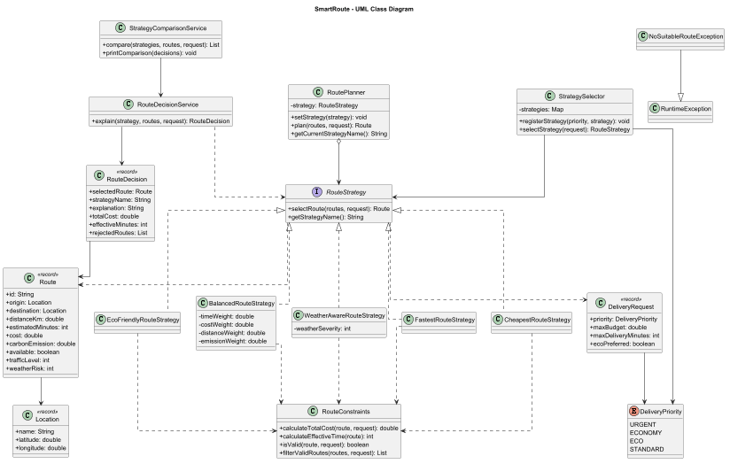
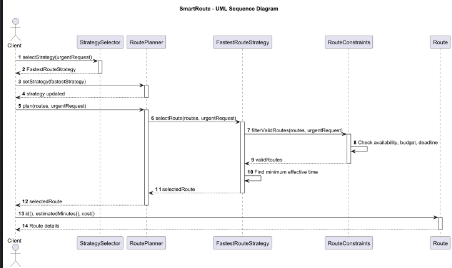

# SmartRoute — Intelligent Delivery Decision Engine

A Java-based delivery route optimization system built using the **Strategy Design Pattern**.

SmartRoute selects suitable delivery routes based on time, cost, distance, environmental impact, and weather conditions. The system supports runtime strategy switching, automatic strategy selection, hard constraints, strategy comparison, and explainable route decisions.

## 1. Technologies

- Java 17+
- Maven
- JUnit 5
- PlantUML
- Git and GitHub

## 2. Project Architecture

SmartRoute follows the Strategy Design Pattern to encapsulate different route selection algorithms.

**Context:** `RoutePlanner`

**Strategy Interface:** `RouteStrategy`

**Concrete Strategies:**

1. `FastestRouteStrategy`
2. `CheapestRouteStrategy`
3. `EcoFriendlyRouteStrategy`
4. `BalancedRouteStrategy`
5. `WeatherAwareRouteStrategy`

**Additional Components:**

- `StrategySelector` — automatically selects a strategy based on delivery priority.
- `RouteConstraints` — validates route availability, budget, and delivery deadline.
- `RouteDecisionService` — explains selected routes and rejected alternatives.
- `StrategyComparisonService` — compares multiple strategies using the same delivery request.
- `NoSuitableRouteException` — handles situations where no valid route exists.

## 3. Route Optimization Strategies

### Fastest Route Strategy

Selects the route with the minimum effective delivery time.

`Effective Time = Estimated Time + Traffic Level × 2`

### Cheapest Route Strategy

Selects the route with the minimum total delivery cost.

`Total Cost = Base Cost + Distance × 50 + Priority Surcharge + Traffic Level × 20`

The urgent delivery surcharge is 500 KZT.

### Eco-Friendly Route Strategy

Minimizes environmental impact using a weighted score.

`Eco Score = Carbon Emission × 0.8 + Distance × 0.2`

### Balanced Route Strategy

Combines four normalized optimization criteria.

`Score = Normalized Time × 0.4 + Normalized Cost × 0.3 + Normalized Distance × 0.1 + Normalized Emission × 0.2`

Weights are configurable and must sum to 1.0.

### Weather-Aware Route Strategy

An additional strategy that accounts for weather severity and route-specific weather risk.

`Weather Score = Effective Time + Weather Risk × Weather Severity × 2 + Traffic Level × 1.0`

This strategy demonstrates how changing environmental conditions can affect route selection.

## 4. Runtime Strategy Switching

SmartRoute supports changing the active algorithm while the application is running.

```java
RoutePlanner planner = new RoutePlanner(new FastestRouteStrategy());

planner.plan(routes, request);

planner.setStrategy(new CheapestRouteStrategy());

planner.plan(routes, request);
```

The same `RoutePlanner` object can use different algorithms without modifying its implementation.

## 5. Automatic Strategy Selection

The `StrategySelector` uses an `EnumMap` to associate delivery priorities with strategies.

| Delivery Priority | Strategy |
|---|---|
| URGENT | Fastest |
| ECONOMY | Cheapest |
| ECO | Eco-Friendly |
| STANDARD | Balanced |

The mapping can be extended using `registerStrategy()`.

## 6. Hard Constraints

Routes must satisfy all mandatory delivery restrictions before optimization.

- The route must be available.
- Total delivery cost must not exceed the maximum budget.
- Effective delivery time must not exceed the deadline.

If no suitable route exists, the system throws `NoSuitableRouteException`.

## 7. Smart Decision Report

The application generates a report explaining the selected route and identifying rejected alternatives.

Example:

```text
Selected route: R-02
Strategy: Fastest Route Strategy

Effective delivery time: 29 minutes
Total cost: 3850 KZT

The selected route is 1 minute faster than R-03.

Rejected alternatives:
R-01: Budget exceeded
R-07: Route unavailable
R-08: Deadline exceeded
```

## 8. Strategy Comparison

The system executes multiple strategies using the same request and candidate routes.

Example results:

| Strategy | Selected Route | Time | Total Cost |
|---|---|---|---|
| Fastest | R-02 | 29 min | 3350 KZT |
| Cheapest | R-05 | 35 min | 2925 KZT |
| Eco-Friendly | R-03 | 30 min | 3120 KZT |
| Balanced | R-03 | 30 min | 3120 KZT |
| Weather-Aware | R-03 | 30 min | 3120 KZT |

## 9. Weather Simulation

The application demonstrates how weather severity influences route selection.

| Weather Severity | Selected Route |
|---|---|
| 0/10 | R-02 |
| 3/10 | R-03 |
| 7/10 | R-03 |
| 10/10 | R-03 |

Weather severity and risk are simulated values, not live weather API data.

## 10. Failure Handling

SmartRoute demonstrates four failure scenarios:

1. Empty route list.
2. Insufficient delivery budget.
3. Invalid Balanced Strategy weights.
4. Unavailable routes.

Exceptions are handled explicitly rather than returning unexplained null values.

## 11. Automated Testing

JUnit 5 is used to test strategy behavior and application constraints.

The test suite includes 15 automated tests covering:

- All five strategies.
- Runtime strategy switching.
- Automatic strategy selection.
- Hard constraints.
- Budget and deadline restrictions.
- Invalid strategy weights.
- Empty route lists.
- No suitable route scenarios.
- Strategy comparison.
- Boundary conditions.

Run the tests using:

```bash
mvn test
```

## 12. UML Diagrams

### Class Diagram



### Sequence Diagram



PlantUML source files are available in the `docs` directory.

## 13. SOLID Principles

**Single Responsibility Principle (SRP):** Route selection, strategy selection, constraint validation, and reporting are handled by separate components.

**Open/Closed Principle (OCP):** Additional route selection algorithms can be introduced by implementing `RouteStrategy`, without modifying `RoutePlanner`.

**Dependency Inversion Principle (DIP):** `RoutePlanner` depends on the `RouteStrategy` interface instead of concrete implementations.

## 14. Why Strategy Instead of If/Else?

Strategy encapsulates each optimization algorithm in a separate class.

Unlike a large conditional structure, this design allows algorithms to be tested independently, replaced at runtime, and extended without modifying the Context.

## 15. Strategy vs Bridge Pattern

The Strategy Pattern focuses on interchangeable algorithms that solve the same problem in different ways.

The Bridge Pattern separates an abstraction from its implementation so both can evolve independently.

In SmartRoute, Strategy is appropriate because the primary requirement is switching between route optimization algorithms.

## 16. Adding a New Strategy

To add another optimization algorithm:

1. Create a class implementing `RouteStrategy`.
2. Implement `selectRoute()` and `getStrategyName()`.
3. Register the strategy if automatic selection is required.
4. Add the strategy to comparison mode if desired.
5. Write meaningful unit tests.

The `RoutePlanner` implementation does not need to change.

## 17. Current Limitations

- Route information is simulated rather than retrieved from a real mapping service.
- Traffic and weather conditions are manually defined.
- Optimization scores use simplified business assumptions.
- Some strategy explanations depend on strategy names.
- The current system selects from predefined candidate routes rather than generating new road paths.

Possible future improvements include live traffic integration, real weather APIs, route visualization, and more advanced optimization algorithms.

## 18. Running the Application

Requirements: Java 17+ and Maven.

Compile and test:

```bash
mvn clean test
```

Run `com.smartroute.demo.Main` from IntelliJ IDEA.

The application demonstrates runtime strategy switching, automatic strategy selection, decision reports, strategy comparison, weather simulation, and failure handling.

---

**Project:** SmartRoute — Intelligent Delivery Decision Engine  
**Assignment:** Assignment 5 — Strategy Pattern  
**Language:** Java  
**Build System:** Maven


## Interactive Delivery Simulator

SmartRoute includes an interactive console application that allows users to create delivery requests with custom conditions.

Users can:
- Select a delivery priority: URGENT, ECONOMY, ECO, or STANDARD.
- Enter a maximum delivery budget.
- Specify a delivery deadline.
- Receive an automatically optimized route recommendation.
- View effective delivery time, total cost, distance, and CO2 emissions.
- Handle invalid inputs and unavailable delivery routes.
- Repeat the simulation or exit the application.

The simulator uses the existing StrategySelector, RoutePlanner, and RouteConstraints components without duplicating route optimization algorithms.

### Example

```text
Choose delivery priority:
1. URGENT
2. ECONOMY
3. ECO
4. STANDARD
0. EXIT

Your choice: 1
Enter budget (KZT): 5000
Enter deadline (minutes): 40

RECOMMENDED ROUTE
Strategy: Fastest Route Strategy
Route: R-02
Effective time: 29 min
Total cost: 3850.00 KZT
```

To run the simulator, execute:

`com.smartroute.demo.InteractiveDeliverySimulator`

from IntelliJ IDEA.

